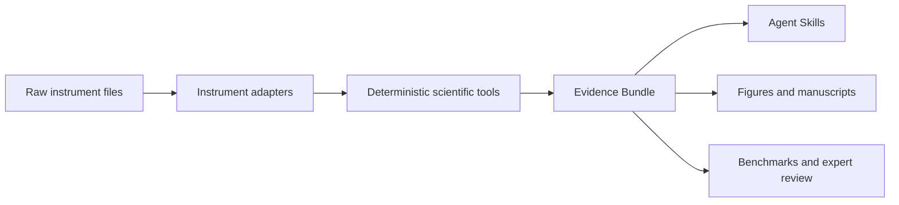

# SciPhys OS

[](https://github.com/sciphys-ai/sciphys-os/actions/workflows/ci.yml)
[](LICENSE)
[](specs/evidence-bundle.schema.json)

**The open agent stack for experimental science.**

SciPhys OS turns raw instrument data into traceable analyses, reproducible figures, and evidence-grounded scientific claims. XRD is the first working vertical slice; the architecture is designed to scale across Raman, spectroscopy, SEM/TEM, AFM, thermal analysis, electrochemistry, and future community plugins.

The durable product is not a collection of prompts. It is a shared evidence protocol connecting raw files, deterministic tools, agent Skills, evaluations, and expert review.

## Try it

```bash
git clone https://github.com/sciphys-ai/sciphys-os.git
cd sciphys-os
corepack enable
pnpm install
pnpm build
node dist/scripts/sciphys.js xrd inspect examples/zno.xy
node dist/scripts/sciphys.js evidence validate examples/evidence-bundle.example.json
node dist/scripts/sciphys.js plugin validate registry/plugins/xrd-core.json
```

Install or inspect the agent Skills with any compatible Skills client:

```bash
npx skills add sciphys-ai/sciphys-os --list
npx skills add sciphys-ai/sciphys-os --skill analyze-instrument-data
```

The XRD command currently accepts two-column text exports. Library parsers also cover selected Bruker RAW and PANalytical XRDML variants; the CLI will expand as adapters satisfy the plugin contract.

## One architecture, many instruments



The boundaries are explicit:

| Layer | Stable contract | How it scales |
|---|---|---|
| Data | SciPhysData and provenance schemas | New vendor formats map into shared types |
| Tools | Parsers, QC, fitting, matching, transforms | Deterministic modality plugins |
| Evidence | Nodes, lineage, claims, reviews | Common across all instruments |
| Skills | Analyze, plot, write, audit | Orchestrate tools without duplicating science code |
| Evaluation | Regression, capability, scientific-validity suites | Public tasks plus governed hidden test sets |

See [architecture](docs/ARCHITECTURE.md), [interoperability](docs/INTEROPERABILITY.md), and the [plugin manifest](specs/plugin-manifest.schema.json). Every declared capability maps to an explicit runtime operation and handler, so registry entries can be validated before loading.

## Included today

### Agent Skills

- `analyze-instrument-data`: modality-neutral analysis with QC, provenance, and uncertainty.
- `make-scientific-figure`: reproducible figure bundles and integrity checks.
- `write-evidence-grounded-results`: manuscript prose backed by a claim ledger.
- `audit-scientific-claims`: structural and scientific review of claim-to-evidence links.

Each Skill is inspectable under [`skills/`](skills/) and keeps deterministic work in scripts or typed code.

### XRD vertical slice

- parsers for common text exports, selected Bruker RAW versions, and PANalytical XRDML;
- peak detection, starter phase references, matching, profile fitting, and refinement helpers;
- evidence-first CLI output with raw-file hash, candidate alternatives, and warnings;
- eight synthetic regression cases for preventing code regressions.

The synthetic suite is deliberately called a **regression suite**, not an external scientific benchmark. Real, licensed, expert-labeled evaluation data belongs in [sciphys-bench](https://github.com/sciphys-ai/sciphys-bench).

## Evidence Bundle

An Evidence Bundle is the interoperability boundary between tools and agents. It records:

- immutable or content-addressed raw inputs;
- processes, parameters, software versions, and derived artifacts;
- directed provenance edges;
- scientific claims classified as observations, derived results, interpretations, or hypotheses;
- expert review decisions and rationale.

Validate the [example bundle](examples/evidence-bundle.example.json):

```bash
pnpm build
node dist/scripts/sciphys.js evidence validate examples/evidence-bundle.example.json
```

## Repository ecosystem

- **[sciphys-os](https://github.com/sciphys-ai/sciphys-os)** — runtime, Skills, instrument adapters, evidence logic.
- **[sciphys-formats](https://github.com/sciphys-ai/sciphys-formats)** — versioned, vendor-neutral data and evidence schemas.
- **[sciphys-bench](https://github.com/sciphys-ai/sciphys-bench)** — benchmark protocols, governed datasets, scoring, and leaderboards.
- **[sciphys-recipes](https://github.com/sciphys-ai/sciphys-recipes)** — executable end-to-end scientific workflows.

The split prevents a single repository from becoming a monolith while preserving shared contracts.

## Evaluation model

We evaluate four distinct things:

1. deterministic code regression;
2. agent capability and tool-use behavior;
3. scientific validity on licensed, expert-labeled data;
4. reproducibility and evidence completeness of end-to-end recipes.

Read [evaluation](docs/EVALUATION.md). Public tests make contribution easy; versioned hidden sets reduce benchmark gaming. Dataset provenance, licenses, subgroup coverage, and expert adjudication are part of the benchmark, not paperwork around it.

## Contributing

You can contribute without implementing an entire modality:

- report a real file that an adapter cannot parse;
- add a licensed, anonymized fixture and expected metadata;
- improve a Skill, schema, reference provenance, or evaluation case;
- implement one parser/QC/analysis plugin;
- publish a reproducible recipe with an Evidence Bundle;
- review a scientific claim or benchmark label in your domain.

Start with [CONTRIBUTING.md](CONTRIBUTING.md), [ROADMAP.md](ROADMAP.md), and the [RFC template](rfcs/0000-template.md). Review [data licensing](DATA_LICENSES.md) before contributing any measurement or reference data.

## Open core and hosted product

Open repositories contain portable schemas, local runtime primitives, Skills, public evaluation protocols, and reproducible examples. SciPhys.ai can build the managed collaboration layer: private data, permissions, compute, organizational knowledge, audit trails, expert networks, and hosted evaluations. Exportability through open Evidence Bundles prevents lock-in.

## Status

SciPhys OS is pre-1.0. XRD support is an initial proof of the architecture, not yet a universal or publication-grade analysis system. Interfaces may change through public RFCs. Do not use automated output as a substitute for domain-expert review.

## License and citation

Code is Apache-2.0. Data and reference assets may have separate terms; see [DATA_LICENSES.md](DATA_LICENSES.md). Cite the repository using [CITATION.cff](CITATION.cff).
